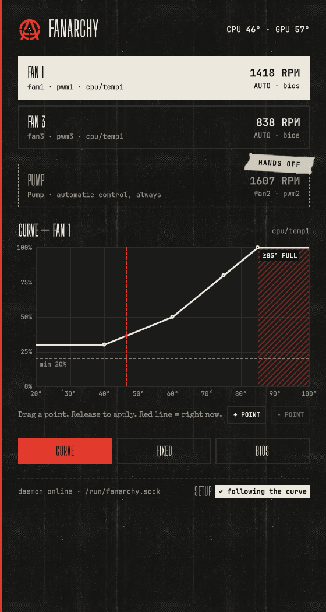

<p align="center">
  
</p>

<h1 align="center">FANARCHY</h1>

<p align="center"><strong>No masters. No stock curves.</strong></p>

<p align="center"><code>yay -S fanarchy</code></p>

---

## What it is

Fanarchy is fan control for [Omarchy](https://omarchy.org): a small root daemon applies your fan curves through the kernel's `hwmon` interface, and an Omarchy shell plugin shows CPU temperature and fan speeds in the bar and lets you drag curves in a panel. Think FanControl from Windows, for Linux.




It has three parts:

- `fanarchyd`: the daemon (root, systemd service). It reads sensors, applies curves and enforces the safety rules.
- `fanarchyctl`: a command line client for the same daemon.
- The plugin (`io.github.babisque.fanarchy`): a bar widget and a panel, talking to the daemon over a Unix socket.

## Install

```sh
yay -S fanarchy                                                   # daemon, CLI, service, fanarchy group
sudo fanarchyctl init                                             # detects your hardware, writes a starter config
omarchy plugin add https://github.com/babisque/fanarchy --enable  # bar widget + panel
```

The package does **not** enable or start the daemon, and the starter config controls **no** fans. Before starting it:

1. Edit `/etc/fanarchy/config.json`: mark the pump first, then add the fans you want controlled (see [Configuration](#configuration)).
2. Check it: `fanarchyd check-config /etc/fanarchy/config.json`
3. Let your user talk to the daemon: `sudo usermod -aG fanarchy "$USER"`, then log out and back in.
4. Start it: `sudo systemctl enable --now fanarchyd`

## Privilege boundary

`fanarchyd` runs as root because writing fan speeds needs it. This is everything it touches:

| What | Access |
| --- | --- |
| `/sys/class/hwmon/*/pwmN` and `pwmN_enable` | **Write**, only for outputs with `"role": "fan"` in the config |
| `/sys/class/hwmon/*` (temperatures, fan RPM, chip names) | Read |
| `/etc/fanarchy/config.json` | Read; written only when you save a curve from the panel or `fanarchyctl set-curve` |
| `/run/fanarchy.sock` | Created by the daemon, owned `root:fanarchy`, mode `0660` (root only if the group is missing) |
| `nvidia-smi` | Run read-only for GPU temperatures, if installed |

What it never does:

- Never writes to an output marked `"role": "pump"`, or to any output that isn't in the config.
- Never writes anything else under `/sys`, and never loads, installs or configures kernel modules.
- Never sets a controlled fan to 0 %: every fan has a `min_percent` floor.

Safety rules, always on:

- CPU above `critical_temp_c` (85 °C by default): every controlled fan goes to 100 %, whatever the curve says.
- A temperature sensor can't be read: the fans that follow it go to `sensor_fail_percent` (100 % by default).
- The daemon stops, crashes or is killed: every controlled fan is handed back to the motherboard (`pwmN_enable = 2`). The service's `ExecStopPost=fanarchyd restore` covers `SIGKILL` and OOM kills too.

The systemd unit is sandboxed (`ProtectSystem=strict`, `ProtectHome`, `ReadWritePaths` limited to `/sys/class/hwmon`, `/etc/fanarchy` and `/run`). Anyone in the `fanarchy` group can change curves and modes through the socket, so only add users you trust with your fans.

## Configuration

`sudo fanarchyctl init` writes a config with your chips and CPU sensor and an empty `fans` list, and prints every PWM output it found:

```text
PWM outputs found (nothing is controlled yet):
  board (it8689_61030507) pwm1: fan1 1473 RPM, automatic (BIOS)
  board (it8689_61030507) pwm2: fan2 1558 RPM, automatic (BIOS)
  board (it8689_61030507) pwm3: fan3 819 RPM, automatic (BIOS)
```

### 1. Mark the pump first

An AIO or custom-loop pump must never be slowed down. Find it (usually the header labelled `PUMP` or `AIO_PUMP` on the board, with a high, steady RPM in `fanarchyctl status` or `sensors`) and add it **before** any fan:

```json
{ "id": "pump", "label": "AIO pump", "chip": "board", "pwm": 2, "role": "pump" }
```

A pump entry has no curve, sensor or speed settings, and the daemon never writes to it. It's listed only so its RPM shows up and so it can't be added as a fan by mistake.

If a header's tachometer isn't `fanN_input` with the same `N` as its `pwmN`, set `"rpm_input": N` to read the right one (works for pumps and fans).

### 2. Add your fans

```json
{
  "id": "case",
  "label": "Case fans",
  "chip": "board",
  "pwm": 3,
  "role": "fan",
  "sensor": "cpu/temp1",
  "curve": [[40, 25], [65, 45], [80, 100]],
  "min_percent": 20
}
```

- `sensor`: `"<chip alias>/tempN"`, any temperature input from the `chips` list.
- `curve`: `[temperature °C, speed %]` points; speed is interpolated between them.
- `min_percent`: the lowest speed the daemon will ever set (1–100; `check-config` warns below 20 %, where many fans stall).
- Optional smoothing: `hysteresis_c`, `step_up_percent`, `step_down_percent`.

A full example is in [`examples/config.example.json`](examples/config.example.json). The socket protocol is in [`docs/protocol.md`](docs/protocol.md).

### 3. Check, start, adjust

```sh
fanarchyd check-config /etc/fanarchy/config.json   # validates it against your hardware, read-only
sudo systemctl enable --now fanarchyd
fanarchyctl status                                  # live temperatures, RPM and speeds
fanarchyctl set-curve case 30:25,60:50,80:100       # or drag the points in the panel
fanarchyctl set-mode case auto                      # hand one fan back to the motherboard
sudo systemctl restart fanarchyd                    # after changing which outputs are controlled
fanarchyctl reload                                  # after editing curves or settings by hand
```

`fanarchyctl reload` refuses a config that adds, removes or moves controlled outputs; restart the service for those.

## Known issues

### Gigabyte boards with ITE chips (`it87`)

Many Gigabyte boards use ITE Super I/O chips (IT8686E, IT8688E, IT8689E…) that the in-kernel `it87` driver doesn't support, so `fanarchyctl init` finds no PWM outputs. The community driver [frankcrawford/it87](https://github.com/frankcrawford/it87) supports them. Installing it is a **manual step**: the Fanarchy package never installs, loads or configures kernel modules.

On many of these boards the driver only loads with:

```text
options it87 ignore_resource_conflict=1
```

**The risk:** the board's ACPI firmware also claims the chip's I/O ports. This option tells the driver to ignore that and use them anyway, so the firmware and the driver can access the chip at the same time. That can give garbled sensor readings, fans jumping to unexpected speeds, and in rare cases problems with other firmware features that use the chip (suspend/resume, board RGB). Most people run it without trouble, but it's your call. Read the driver's README first, and prefer it over the broader `acpi_enforce_resources=lax` kernel parameter.

### `pwmN` reads are meaningless in automatic mode

Some chips (the IT8689E included) report garbage in `pwmN` while `pwmN_enable` is `2`, so `sensors` may show odd percentages for fans the BIOS controls. Trust the RPM. Details in [`docs/hardware-notes.md`](docs/hardware-notes.md).

## Dependencies and services

| Item | Notes |
| --- | --- |
| `fanarchyd.service` | systemd system service. Disabled after install; you enable it. Skipped until `/etc/fanarchy/config.json` exists. |
| `fanarchy` group | Created by `sysusers.d` on install. Members can use the socket. |
| `/etc/fanarchy/` | Created empty by the package. `fanarchyctl init` writes the config. |
| A kernel `hwmon` driver for your board | Usually built in (`nct6775`, `it87`, …); see Known issues for ITE chips. |
| `nvidia-utils` (optional) | For GPU temperatures. |
| `lm_sensors` (optional) | The `sensors` command, handy for finding headers. |
| Omarchy shell | For the plugin. The daemon and CLI work without it. |

## Uninstall

```sh
omarchy plugin remove io.github.babisque.fanarchy
sudo systemctl disable --now fanarchyd   # hands every fan back to the motherboard
yay -R fanarchy
sudo rm -r /etc/fanarchy                 # optional: your config
sudo groupdel fanarchy                   # optional
```

## Development

```sh
cargo build && cargo test
cargo clippy --all-targets -- -D warnings
node --test 'plugin/tests/*.test.mjs'
omarchy plugin validate .
```

## License

[MIT](LICENSE). The fonts in `plugin/assets/fonts/` keep their own licenses (SIL OFL and Apache 2.0), included next to them.
